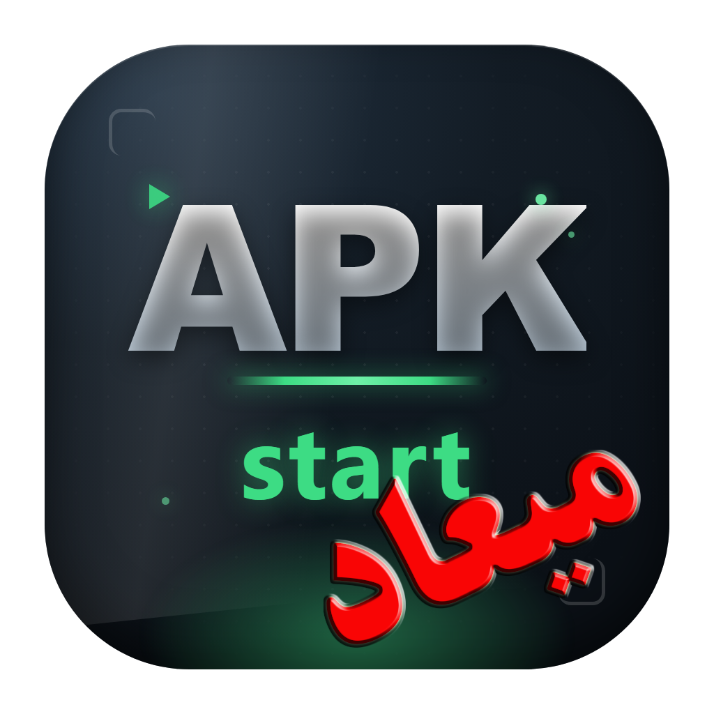

# ApkStart

<p align="center"></p>

<p align="center">
  <a href="README.fa.md">🇮🇷 فارسی</a> ·
  <a href="README.en.md">🇬🇧 English</a>
</p>

[](https://github.com/RoutineMiku/apkstart/actions/workflows/ci.yml)
[](https://github.com/RoutineMiku/apkstart/releases)
[](LICENSE)
[](#)

**اجرای برنامه‌های اندروید در ویندوز، درست مانند نرم‌افزارهای بومی دسکتاپ.** ApkStart فایل‌های APK را نصب می‌کند، برای هر برنامه میان‌بر مستقل ویندوز می‌سازد و هر برنامه اندرویدی را در پنجره‌ای جداگانه اجرا می‌کند.

## قابلیت‌های اصلی

- **نصب با دوبار کلیک روی APK:** پس از اتصال پسوند `.apk` به ApkStart، می‌توانید فایل را مستقیماً از File Explorer نصب کنید.
- **میان‌بر جداگانه برای هر برنامه:** آیکون برنامه از داخل APK استخراج و به فایل ICO ویندوز تبدیل می‌شود؛ سپس می‌توانید برنامه را از میان‌بر اختصاصی خودش اجرا کنید.
- **هر برنامه در یک پنجره مستقل:** برنامه‌های اندروید در پنجره‌های جداگانه اجرا می‌شوند. امکان انتخاب پنجره عمودی با قابلیت تغییر اندازه یا حالت تمام‌صفحه وجود دارد و اندازه پنجره می‌تواند برای هر برنامه به خاطر سپرده شود.
- **یکپارچگی با منوی Start ویندوز:** برای برنامه‌های نصب‌شده میان‌بر دسکتاپ و منوی Start ساخته می‌شود تا از طریق Windows Search نیز قابل دسترسی باشند.
- **اشتراک‌گذاری دوطرفه فایل:** فایل‌های پوشه `%USERPROFILE%\ApkStartShared` با مسیر `/sdcard/ApkStartShared` در اندروید همگام‌سازی می‌شوند.
- **برنامه میزبان سبک:** پوسته دسکتاپ به وابستگی اجرایی جانبی نیاز ندارد. محیط اندروید هنگام نیاز اجرا می‌شود و در صورت سازگاری می‌توان از یک محیط اجرای موجود نیز استفاده کرد.


## دریافت برنامه

نسخه‌های آماده از این مسیرها قابل دریافت هستند:

- [انتشارهای GitHub](https://github.com/RoutineMiku/apkstart/releases)
- [انتشارهای Gitee](https://gitee.com/daily-miku/apkstart/releases)

بسته‌های ارائه‌شده:

- **`ApkStart-v*-Setup.exe`** — بسته نصب شامل اجزای محیط اجرای اندروید است. در نخستین اجرا، اجزا در سیستم استخراج می‌شوند و پس از آن برای دریافت دوباره آن‌ها نیازی به اینترنت نیست.
- **`ApkStart-v*-win64-portable.zip`** — نسخه قابل‌حمل و کم‌حجم‌تر؛ محیط اجرا در نخستین زمان نیاز دانلود می‌شود.

## به‌روزرسانی

از مسیر **Settings → Software update → Check for updates** یا گزینه بررسی به‌روزرسانی در منوی آیکون کنار ساعت ویندوز استفاده کنید. ApkStart منابع انتشار را بررسی و مسیر مناسب دانلود را انتخاب می‌کند. به‌روزرسانی برنامه، محیط اندروید، برنامه‌های نصب‌شده یا snapshotهای ذخیره‌شده در پوشه اطلاعات کاربر را حذف نمی‌کند.

## ساخت از کد منبع

پیش‌نیازها: ویندوز ۱۰ یا ۱۱ نسخه ۶۴ بیتی و Node.js نسخه ۲۰ یا بالاتر.

```powershell
npm install
npm start
```

دستورهای اختیاری:

```powershell
npm run assoc:on       # اتصال فایل‌های APK به ApkStart
npm run pack           # ساخت نسخه قابل‌حمل
npm run runtime        # آماده‌سازی اجزای محیط اجرا
npm run build:exe      # ساخت فایل نصب ویندوز
npm test               # اجرای مجموعه آزمون‌ها
npm run selftest       # بررسی محیط اجرا پس از نصب اندروید
```


## محیط اجرا و سازگاری

ApkStart محیط اجرای اندروید را در مسیر `%APPDATA%\apkstart\runtime` مدیریت می‌کند. راه‌اندازی پیش‌فرض از Android Emulator، ابزار adb و یک تصویر سیستمی اندروید استفاده می‌کند. در صورت وجود، شتاب‌دهی سخت‌افزاری فعال می‌شود و در غیر این صورت امکان بازگشت به رندر نرم‌افزاری وجود دارد. برای برنامه‌هایی که به کتابخانه‌های بومی ARM نیاز دارند، گزینه‌های سازگاری ARM نیز در نظر گرفته شده است؛ بااین‌حال سازگاری نهایی به خود برنامه و سخت‌افزار ویندوز بستگی دارد.

## ساختار پروژه

- `src/main.js` — فرایند اصلی Electron و مدیریت پنجره و نوار اعلان.
- `src/ui/` — رابط کاربری مبتنی بر HTML، CSS و JavaScript.
- `src/core/` — پردازش APK، مدیریت محیط اجرا، نصب برنامه، ساخت میان‌بر، adb و همگام‌سازی فایل.
- `build/` — اسکریپت‌های آماده‌سازی محیط و بسته‌بندی.
- `test/` — آزمون‌های واحد و یکپارچه‌سازی.

## مشارکت در توسعه

ثبت Issue و ارسال Pull Request خوش‌آمد است. لطفاً پیش از ارسال تغییرات، دستور `npm test` را اجرا کنید. جزئیات بیشتر در [CONTRIBUTING.md](CONTRIBUTING.md) آمده است.

## توسعه‌دهنده و مجوز

توسعه و نگهداری پروژه توسط **RoutineMiku** انجام می‌شود.

- [مخزن اصلی پروژه](https://github.com/RoutineMiku/apkstart)
- [مجوز MIT](LICENSE)

کد برنامه تحت مجوز MIT منتشر شده است. تصویرهای سیستمی اندروید، فایل‌های اجرایی Emulator و اجزای Google جداگانه دریافت می‌شوند و تابع مجوزهای مربوط به خود هستند.
